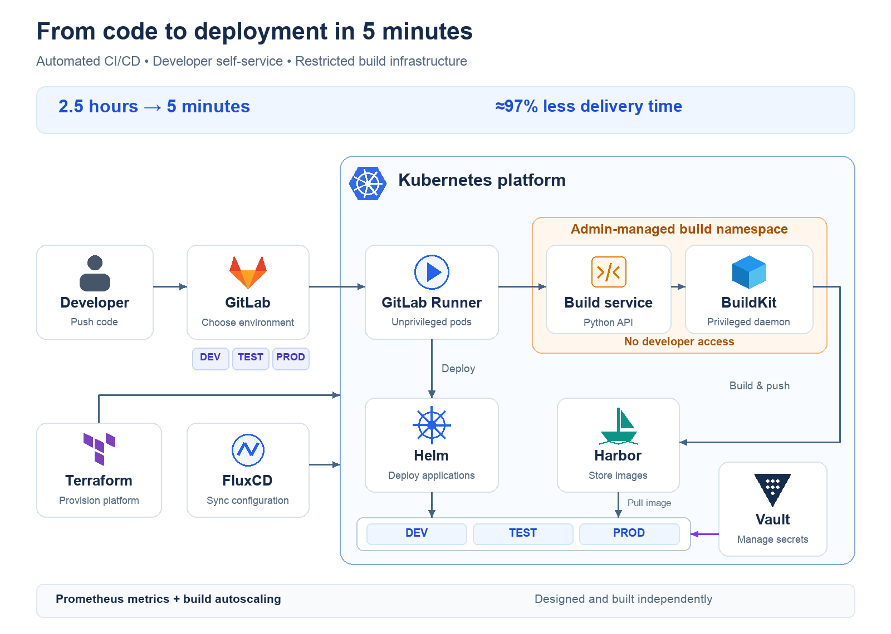

# Kubernetes Build & Deployment Template

A generic template for GitLab CI/CD, an administrator-managed Python BuildKit service, Harbor-compatible image storage, and Helm application deployment. All application names, endpoints, registry projects, and secret paths are synthetic.

## Included

- A small Python HTTP sample application and container image.
- A synchronous build API with per-replica concurrency limits, Prometheus metrics, authentication, archive validation, and timeouts.
- Separate DEV, TEST, and PROD build namespaces and image repositories.
- Unprivileged CI jobs calling an administrator-managed privileged BuildKit daemon through a Unix socket sidecar.
- GitLab environment selection, immutable commit tags, and a manual Helm deployment step.
- Namespace-scoped application deployment permissions, network policies, and optional Vault and HPA examples.
- Setup instructions, security boundaries, and automated local validation.

## Architecture



[Vector diagram](docs/kubernetes-delivery.svg). The existing diagram describes the wider source architecture and its self-reported result; it is not a timing guarantee or a complete specification of this template. Terraform infrastructure provisioning and FluxCD bootstrapping are outside this template's scope.

```text
GitLab pipeline (DEV / TEST / PROD)
  -> unprivileged runner job in app-<environment>
  -> authenticated Python API in build-<environment>
  -> BuildKit sidecar over a pod-local Unix socket
  -> registry.example.com/demo-<environment>/sample-app:<commit>
  -> manual Helm deployment into app-<environment>
```

Each environment has its own API token and registry push identity. Developers can invoke the approved build API; access to build namespace pods, exec, secrets, and privileged infrastructure remains administrator-controlled. Submitted Dockerfiles execute code: use dedicated build nodes and trusted teams, not hostile tenants.

## Start here

1. Follow [setup](docs/setup.md) to configure endpoints, images, secrets, runners, and deployment credentials.
2. Read the [security and sanitization notes](docs/security.md) before using or publishing a customized copy.
3. Run local validation:

```sh
make validate
```

This runs gateway tests with a mocked BuildKit command, Helm lint/render checks, and Kustomize rendering for every environment. It does not connect to Kubernetes or deploy anything.

## Repository layout

```text
build-service/       Python gateway and Dockerfile
sample-app/          Synthetic application and Dockerfile
ci/                  Administrator-owned CI tools image
scripts/             Allowlisted sample context uploader
k8s/admin/           Environment namespaces and application deployment RBAC
k8s/build/           Build service base and DEV/TEST/PROD overlays
k8s/optional/        Vault synchronization and illustrative CPU HPA
helm/sample-app/     Sample application chart and environment values
tests/              Gateway behavior and archive security tests
docs/               Setup, security notes, and portfolio architecture diagram
```

## Build API

`POST /build?tag=<commit>` accepts an `application/gzip` tar archive with a root `Dockerfile`, an explicit Content-Length, and `Authorization: Bearer <token>`. The destination repository is configured by the administrator; callers select only the tag. Defaults: two active builds per replica, 20 MiB upload, 100 MiB expanded context, 10,000 entries, and a 900-second build timeout. Links, devices, absolute paths, and parent traversal are rejected. Full build logs are deliberately suppressed to avoid disclosing sensitive output.

`GET /health` checks the gateway, `/ready` checks BuildKit workers, and `/metrics` exposes aggregate build counts, active slots, utilization, and duration. HTTP 503 means no capacity; resubmit explicitly rather than automatically duplicating an uncertain build. This synchronous example has no durable queue or build cancellation API.

## Case study context

I independently built the source platform. Application delivery time decreased from 2.5 hours to 5 minutes, approximately 97% less time. This is a self-reported project result, not a benchmark for this template.

## Public content policy

Use synthetic examples, placeholder hostnames, and references to externally managed secrets. Exclude client names, private project and service identifiers, internal endpoints, credentials, certificates, infrastructure state, logs, and production configuration. This template was recreated from selected architectural patterns; private repository files and Git history were not imported.
